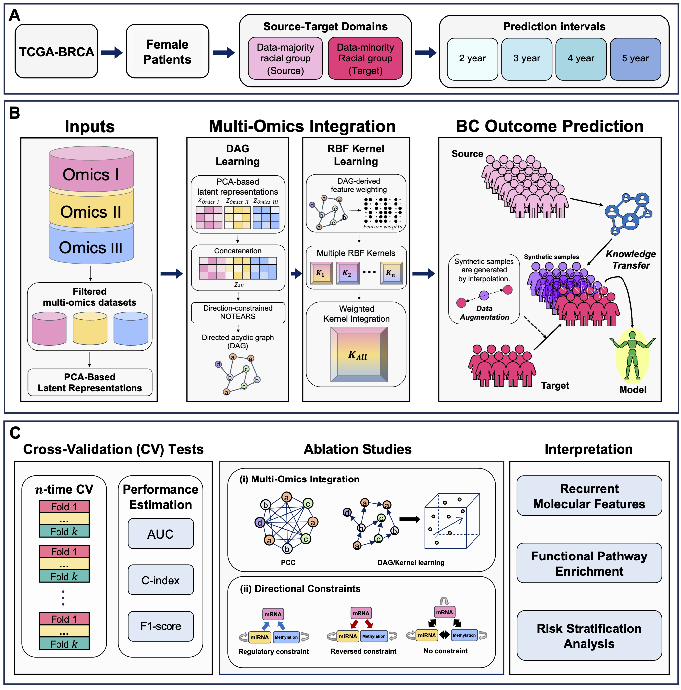

<h1><strong>DAG-HEART</strong></h1>
<p>
  <strong><ins>D</ins></strong>irected <strong><ins>A</ins></strong>cyclic 
  <strong><ins>G</ins></strong>raph-Gided <strong><ins>H</ins></strong>ealth 
  <strong><ins>E</ins></strong>quity-<strong><ins>A</ins></strong>ware <string><ins>R</ins></strong>epresentation 
  <string><ins>T</ins></strong>ransfer Learning Framework for Breast Cancer
</p>

## Overview
Breast cancer outcome prediction remains challenging for underrepresented populations because genomic datasets are demographically imbalanced and conventional multi-omics integration largely relies on undirected molecular similarity. We developed DAG-HEART, a directed acyclic graph-guided multi-omics transfer-learning framework that extends our previous transfer learning strategy with data augmentation. Using TCGA-BRCA mRNA, miRNA, and DNA-methylation data, DAG-HEART was evaluated for progression-free interval prediction in a data-minority group. DAG-guided nonlinear integration consistently improved predictive performance relative to direction-agnostic and correlation-based representations, while biologically motivated directional constraints generally outperformed reversed or unconstrained structures. Recurrently selected features converged on extracellular-matrix and regulatory pathways and supported clinically meaningful risk stratification. DAG-HEART provides an interpretable strategy for combining directed multi-omics structure with transfer learning under data imbalance across racial groups to address **breast cancer racial disparities**.

<p align="center">
  
</p>

## Table of Contents
- [Requirements](#requirements)
- [Installation](#installation)
- [Instructions](#instructions)
- [Troubleshooting](#troubleshooting)

## Requirements
This model requires following python packages. 

| Packages         | Version                       |
|--------------------|----------------------------|
| numpy              | 1.21.6                     |
| pandas             | 1.3.5                      |
| tensorflow         | 2.11.0                     |
| keras              | 2.11.0                     |
| theano             | 1.0.5                      |
| scikit-learn       | 1.2.2                      |
| imbalanced-learn   | 0.10.1                     |
| scipy              | 1.10.1                     |

## Installation
1. Clone the _**DAG-HEART**_ git repository
```bash
git clone https://github.com/wan-mlab/DAG-HEART.git
```
2. Navigate to the directory of _**DAG-HEART**_ package
```bash
cd /your_path/DAG-HEART
```

## Instructions

```
usage: run_DAG_HEART.py [-h] --in_path IN_PATH --out_path OUT_PATH --cpoint CPOINT --year YEAR

This script implements DAG-HEART designed to improve breast cancer prognosis in underrepresented populations. It integrates biologically constrained directed acyclic graph learning with nonlinear multi-omics kernel integration, transfer learning, and target-domain data augmentation. DAG-derived molecular structure is used to guide patient-similarity representations across mRNA, miRNA, and DNA methylation data. The model transfers knowledge from the data-rich European-ancestry source domain to the data-limited African-ancestry target domain using contrastive domain adaptation.

optional arguments:
  -h, --help            show this help message and exit
  --in_path IN_PATH     Path to the input multi-omics data and other materials
                        for model training.
  --out_path OUT_PATH   Path for all output files after model training.
  --cpoint CPOINT       Clinical endpoint of interest for prognosis prediction
                        (e.g., PFI, DSS).
  --year YEAR           Time threshold used to define positive prognosis events.
```

## Example  

```
python run_DAG_HEART.py \
      --in_path /home/user/project/input \
      --out_path /home/user/project/output \
      --cpoint PFI \
      --year 3
```

## Troubleshooting 

We kindly ask users and contributors to utilize the Issues section of this repository for reporting bugs, requesting new features, or documenting any technical difficulties encountered during usage. We monitor submitted issues regularly and will do our best to respond in a timely and constructive manner. 

## Citation (To be updated)
*“DAG-HEART: Directed Acyclic Graph-Guided Health Equity-Aware Representation Transfer Learning Framework for Breast Cancer”*  
_Author1, Author2, et al. (Year)_
